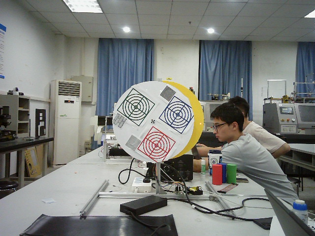

# RGB-D Laser Turret

基于 RGB-D 视觉的彩色目标识别与双自由度激光云台瞄准原型。系统使用深度图定位圆形靶盘，在 RGB 图像中识别红、绿、蓝目标，根据二维码给出的颜色顺序计算目标方位，并通过串口向下位机发送俯仰角与偏航角。



## 系统流程

```text
二维码读取目标顺序
        ↓
深度分层与连通域分析提取靶盘 ROI
        ↓
Hough 圆检测 + HSV 全局匹配识别内部三色目标
        ↓
HSV 分割识别靶盘外部彩色目标
        ↓
亮度阈值与中值滤波检测激光光斑
        ↓
像素坐标 → 平面毫米坐标 → Pitch / Yaw
        ↓
串口发送至双自由度云台控制器
```

## 主要功能

- OpenNI2 深度相机采集，默认分辨率 `640×480@30 FPS`
- 按深度区间分层，结合形态学处理和最小外接圆提取圆形靶盘
- 使用 Hough 圆、HSV 特征和一对一全局匹配识别靶盘内部三色目标
- 使用 HSV 阈值与轮廓分析识别靶盘外部目标
- 检测并中值滤波激光高亮点
- 根据靶盘实际直径估计像素尺度，计算 Pitch/Yaw
- 通过串口向云台下位机发送角度命令
- 支持保存图像后的离线调试与实验性 GroundingDINO 检测

## 目录结构

```text
.
├── class521_9_color_final_final.py        # 当前主程序：几何前馈控制
├── class521_9_color_final_final_close.py  # 实验性激光误差比例闭环
├── class521_9_color_final_final_dino.py   # 实验性 GroundingDINO 版本
├── class521_9_color_final_final_wzy.py    # 协作/简化版本
├── class521_9_color_final_offline.py      # 离线图像调试版本
├── utils/
│   ├── roi.py                             # 深度 ROI 与圆形靶盘定位
│   ├── detect.py                          # 内外部彩色目标识别
│   ├── laser.py                           # 激光光斑检测
│   ├── space.py                           # 像素、毫米和角度换算
│   ├── serial_send.py                     # 串口协议
│   └── utils.py                           # 通用图像处理函数
├── OpenNI2/                               # Windows OpenNI2 驱动运行库
├── assets/                                # 示例图像与离线深度帧
└── docs/PROJECT_NOTES.md                  # 实现说明与已知限制
```

## 环境

- Python 3.10+（原项目曾在 Python 3.12 环境中运行）
- Windows
- OpenCV、NumPy、PySerial
- OpenNI2 Python 包及兼容的 RGB-D 相机驱动
- 双自由度云台控制器

安装 Python 依赖：

```bash
pip install -r requirements.txt
```

`from openni import openni2` 所需的 Python 封装与设备驱动需要根据相机型号单独安装。仓库中的 `OpenNI2.dll` 和 `OpenNI2/Drivers` 来自原实验环境，仅用于复现参考。

## 运行前配置

当前代码仍有若干与原实验装置绑定的参数，运行前需要检查：

- `cv2.VideoCapture(1)`：RGB 相机编号
- `COM11`：下位机串口号
- 深度范围 `500–1500 mm`
- 靶盘真实直径 `350 mm`
- 相机与激光云台的垂直补偿 `140 mm`
- ROI 中心经验偏移和角度方向

## 运行

连接深度相机、RGB 相机和下位机后：

```bash
python class521_9_color_final_final.py
```

程序启动后先扫描二维码；二维码中的 `1/2/3` 分别代表红、绿、蓝目标顺序。扫描阶段可按 `q` 使用默认红色目标。

## 当前状态

这是从真实实验代码整理出的原型仓库，主链路已经覆盖目标感知、坐标换算和串口控制，但尚未作为通用软件发布。特别需要注意：

- 主版本主要是目标坐标到云台角度的几何前馈，不是完整视觉伺服闭环
- `close` 版本仅实现了初步的比例误差修正
- 相机内外参和云台轴心偏移尚未采用规范标定流程
- 阈值、串口号与补偿量仍有硬编码
- GroundingDINO 文件是实验分支，需要另外安装源码与权重
- 尚未提供端点误差、收敛时间、成功率与实时帧率等量化评测

更详细的实现和风险说明见 [项目说明](docs/PROJECT_NOTES.md)。

## 后续计划

- [ ] 增加设备与算法参数配置文件
- [ ] 补全 ROI 为空和设备断连时的异常处理
- [ ] 完成相机—激光—云台坐标系标定
- [ ] 实现带死区、限幅和丢失保护的 P/PID 视觉伺服
- [ ] 增加端点误差、收敛时间、成功率和 FPS 评测
- [ ] 整理演示视频与硬件系统框图

